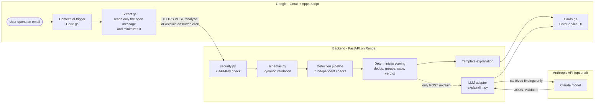

# Malicious Email Scorer - a Gmail Add-on

When a user opens an email in Gmail, this add-on shows a **0-100 risk score**, a **verdict**
(Low risk / Suspicious / Likely malicious) and **the evidence behind every point**. It targets
phishing that reaches the inbox: look-alike sender domains, spoofed senders, deceptive links, risky
attachments and credential or payment requests. The decision is made by a **deterministic,
explainable rule engine** in a small Python backend - every point traces to a named signal and a
piece of evidence. An **optional "Explain with AI" button** asks an LLM to reword the finished result
in plain language; the LLM never sees the email text and cannot change the score or verdict.

**For reviewers in a hurry** - no Gmail account or API key needed:

```bash
cd backend && python -m venv .venv && . .venv/bin/activate   # Windows: .venv\Scripts\activate
pip install -r requirements-dev.txt
pytest -q                          # 344 tests, offline
python -m demo.run_demo full       # a phishing example, scored and explained
```

## Contents

[Preview](#product-preview) · [Features](#key-features-and-scope) · [Architecture](#system-architecture) ·
[Detection](#detection-engine) · [Scoring](#deterministic-risk-scoring) · [Decisions](#engineering-decisions-and-trade-offs) ·
[Security](#security-and-privacy) · [Setup](#installation-and-setup) · [Testing](#testing-and-validation) ·
[Limitations](#known-limitations-and-future-improvements) · [Demo](#live-demo) · [Structure](#repository-structure)

## Product preview


_The add-on in Gmail on a synthetic test email (attachment `invoice.pdf.html`): Suspicious, 30/100, with the
AI explanation requested. The card is built with Google CardService and contains, in order:_

1. **Security verdict · rule-based engine** - verdict, risk score, the rule that decided it, and the main findings.
2. **Explain with AI** button (shown only when the backend has an LLM key), or an
   **"In plain words"** summary generated from the same findings by a fixed template.
3. **Technical findings** - each signal with its points and evidence, e.g.
   `paypa1-secure.com resembles PayPal (paypal.com): it combines the brand name with account or security words`.
4. **Reassuring signs** - e.g. DMARC pass, with the caveat that it proves who sent the email, not that the sender is trustworthy.
5. **What was checked** - the status of every check; checks that could not run are listed, never treated as "safe".

## Key features and scope

| Capability | What it contributes |
|---|---|
| **Sender authentication** | Interprets the SPF, DKIM and DMARC results Gmail recorded, trusting only Gmail-stamped results. Catches spoofing of a real domain. |
| **Sender impersonation** | Look-alike domains of protected brands (homoglyphs, typos, brand + "secure-login"-style words), brand names in the display name, addresses hidden in the display name, Reply-To diversion. Catches attackers who own their domain and pass authentication. |
| **Link analysis** | Link text that shows one site but leads to another, look-alike destinations, raw IP addresses (incl. disguised notations), the `user@host` trick, deceptive structure, shorteners, abused TLDs. Links are parsed, never opened. |
| **Attachment metadata** | Executables and scripts, macro-enabled Office files, web pages and disk images, double extensions (`invoice.pdf.exe`), name vs. declared type mismatches. File contents are never read. |
| **Content signals** | Requests for credentials or money (payment, changed bank details), with urgency or account threats as supporting context. English and Hebrew. |
| **Explain with AI** (optional) | On request, an LLM rewords the finished result for non-technical users. Falls back to a deterministic summary. |

**Scope.** The goal is a focused product whose every decision can be explained, not a full email-security
platform. Reputation feeds, organization-specific policies, sandboxing and ML classification were left
out deliberately; see [Limitations](#known-limitations-and-future-improvements).

## System architecture



**Trust boundaries.** Email content is attacker-controlled everywhere it appears. Only the add-on can read
Gmail; the backend receives a minimized, validated payload; the LLM receives only sanitized findings and
its output is treated as untrusted text.

| Component | Owns | Key files |
|---|---|---|
| Gmail add-on (Google Apps Script) | Read the opened message with a per-message token, minimize data, call the backend, render the card | `addon/Code.gs`, `Extract.gs`, `Api.gs`, `Cards.gs`, `appsscript.json` |
| Backend API (FastAPI) | Authentication, size limit, schema validation, logging | `backend/app/main.py`, `security.py`, `schemas.py` |
| Detection engine | Checks, scoring and verdict - no network access | `backend/app/engine/` |
| Explanation layer | Wording only, after scoring | `backend/app/explain/` |

| Endpoint | Purpose |
|---|---|
| `GET /health` | Liveness and version |
| `POST /analyze` | Called on every opened email. Deterministic result + template explanation; **never calls the LLM**. Returns `ai_explanation_available`. |
| `POST /explain` | Called only by the "Explain with AI" button. Accepts the same message (never a score or verdict), **re-runs the engine**, then adds the AI explanation. |

## Detection engine

The engine parses the request once into a normalized context, runs seven independent checks, and
scores their findings. A failing check is reported as `failed` and the others still run. Full signal
reference: [docs/detection-design.md](docs/detection-design.md).

- **Sender authentication** (`checks/authentication.py`). Anyone can write an `Authentication-Results`
  header, so results are used only when stamped by Gmail (`authserv-id = mx.google.com`) and matching the
  From domain. When DMARC was evaluated, its result decides and SPF/DKIM failures are counted as part of
  it; forwarded mail that fails SPF but passes DMARC is not penalized.
- **Sender impersonation** (`checks/lookalike.py`, `display_name.py`, `reply_to.py`, `domains.py`).
  Look-alike detection is binary: a supported technique matches with sufficient evidence, or nothing is
  reported. Safeguards: official and RDAP-verified brand-owned domains (`google-analytics.com`), a
  separate list of unrelated look-alikes (`paypay.ne.jp`, `unwind.com`), whole-label matching
  (`applebees.com` is not Apple), realistic-typo rules (adjacent keys, missing/extra/swapped letter),
  registered domains from the offline Public Suffix List, and punycode shown in evidence.
- **Links** (`checks/links.py`, `urls.py`). The add-on sends only `scheme://[user@]host[:port]` and the
  visible text when that text is itself an address. Click-tracking and security link-rewriting services
  are excluded from text/destination mismatches.
- **Attachments** (`checks/attachments.py`). Name, declared MIME type and size only. Extensions are read
  as Windows would (hidden right-to-left characters and trailing dots removed).
- **Content** (`content.py`). Per sentence: a credential word plus an action verb, or a payment word plus
  an action verb, or bank details plus a change word. Urgency and threats count only next to such a
  request; single keywords never count.

**Not implemented**: attachment content inspection, malware scanning, URL fetching, reputation lookups,
ML classification.

## Deterministic risk scoring

Weights live in one file, `backend/app/engine/signals.py`; checks report evidence, never points.
`backend/app/engine/scoring.py` applies five rules:

1. **Deduplication** - a signal counts once however many links or files trigger it; their evidence is merged.
2. **Correlation groups** - signals describing one behaviour count once (e.g. a DMARC failure and the SPF failure that caused it; a look-alike Reply-To and a plain Reply-To mismatch).
3. **Reinforcement** - a weaker finding about the *same* brand or file as a stronger one in the same category adds only 5 points.
4. **Category caps** - authentication 30, sender identity 45, links 35, attachments 35, content 15.
5. **Sum, bounded to 100.** Positive evidence (DMARC pass) is shown but never subtracted.

| Category (cap) | Signals and points |
|---|---|
| Authentication (30) | DMARC fail 25 · SPF fail 10 · SPF softfail 5 · DKIM fail 8 · no DKIM signature 3 |
| Sender identity (45) | Look-alike sender domain 35 · look-alike Reply-To 20 · free mailbox claiming an organization 12 · brand in display name 10 · address in display name 10 · Reply-To mismatch 6 |
| Links (35) | Text vs. destination mismatch 25 · look-alike destination 15 · IP host 15 · `@` trick 15 · deceptive structure 8 · abused TLD 5 · shortener 5 · plain http 3 |
| Attachments (35) | Executable/script 30 · macro document 20 · web page/disk image 15 · double extension 15 · type mismatch 5 |
| Content (15) | Credential request 10 · money request 10 · pressure 5 |

**Verdict**: 0-29 **Low risk** (worded "no strong warning signs", never "safe"), 30-69 **Suspicious**,
70-100 **Likely malicious**. A single counted high-severity finding (e.g. a look-alike domain) raises Low
risk to Suspicious - never higher. No category cap reaches 70, so **Likely malicious requires evidence
from more than one category**. If no check could run, the verdict is **Inconclusive** with no score.
**Missing data never adds points** and is never reported as safe; the response lists what could not be
checked and the maximum score the completed checks could have produced.

### Worked example

Reproduce with `python -m demo.run_demo full`. Synthetic input: sender `"PayPal Service" <service@paypa1-secure.com>`
(authenticated - DMARC pass), a link displayed as `https://www.paypal.com` pointing to
`https://paypal-verify-login.com`, an attachment `PayPal_Form.html`, and the text "Your account will be
suspended within 24 hours. Please verify your password."

| Category | Finding | Points | Why |
|---|---|---|---|
| Authentication | DMARC pass | 0 | Shown as a reassuring sign; not subtracted |
| Sender identity | Look-alike sender domain | 35 | `paypa1` + `secure` |
| | Brand in display name | **5** of 10 | Reinforces the look-alike (same brand) |
| Links | Text vs. destination mismatch | 25 | Shows paypal.com, opens another site |
| | Look-alike destination | **5** of 15 | Reinforces the mismatch (same brand) |
| Attachments | Web page attachment | 15 | `.html` |
| Content | Credential request | 10 | "verify your password" |
| | Pressure | 5 | "suspended within 24 hours", next to a request |
| **Total** | | **100** | 40 + 30 + 15 + 15 = 100 -> **Likely malicious** |

The raw weights of these findings add up to 115 (35 + 10 + 25 + 15 + 15 + 10 + 5). Reinforcement removes
15 points that would count the same PayPal impersonation twice, leaving 100; no category cap is reached here.

**Why deterministic.** The same email always gets the same score, every point is traceable and
unit-testable, and attacker-written text cannot argue with a rule the way it can with an LLM prompt.
**The weights are engineering heuristics** - chosen by how specific a signal is to malicious mail, how
common it is in legitimate mail, whether it is independent of other findings, and its impact. **They
are not statistically calibrated**: no labelled dataset was used. The score is a risk score, not a probability.

## Engineering decisions and trade-offs

The rationale column describes the engineering reasoning for each choice.

| Decision | Rationale | Trade-off / limitation |
|---|---|---|
| Google Apps Script Workspace add-on | Native Gmail integration; Google-managed OAuth with a per-message token, so only the opened email is readable | 30 s limit per action, limited UI (CardService), JavaScript without a test framework in this repo |
| Backend instead of logic in the add-on | Detection in Python is unit-testable (344 tests) and has one source of truth | Minimized email data leaves Google; one more service to run |
| FastAPI + Pydantic | Typed contract with length limits and unknown-field rejection in little code | Python hosting needed (Render free tier sleeps when idle) |
| Deterministic scoring | Reproducible, explainable, resistant to manipulation by email text | Heuristic weights; fixed rules miss novel patterns |
| Correlation groups, reinforcement, category caps | One behaviour is not counted twice; no single category dominates | More rules to explain; a strong single signal stays at Suspicious |
| Metadata-only attachments | No need to download or execute untrusted files; no contents leave Gmail | A malicious file with an ordinary name is not detected |
| Rule-based content analysis (EN/HE) | Transparent, testable, no model | Paraphrasing evades it; legitimate security notices produce minor findings |
| Host-only links | Password-reset tokens and tracking IDs never leave Gmail | Paths and redirect parameters are not inspected |
| AI explanation on demand | No paid call or data transfer on email open; user-initiated | One extra click; first click after a restart can be slower |
| Template fallback | The result is always complete without an LLM | Less natural wording |

## Security and privacy

- **Least privilege.** Scopes: `gmail.addons.execute`, `gmail.addons.current.message.readonly` (only the
  opened message, via a short-lived token from the trigger event), `script.external_request`. No access
  to the rest of the mailbox. `urlFetchWhitelist` restricts outbound calls to the backend.
- **Data minimization in the add-on.** Selected headers; links reduced to `scheme://[user@]host[:port]`
  (path, query, fragment and any password removed); link text only when it is an address; attachment name/type/size; at most 8,000 characters of
  text with every web address replaced by `[link]`. A failed extraction is sent as "not collected", not as empty.
- **Backend authentication.** Shared secret in `X-API-Key`, compared in constant time; requests are
  rejected if the server has no key configured (fails closed).
- **Input validation.** Pydantic models with per-field length limits and `extra="forbid"`; 64 KB body
  limit (enforced on the `Content-Length` header); parsers that never raise on malformed headers;
  bounded regular expressions, tested with hostile input.
- **Rendering.** Every email-derived string is HTML-escaped before display, because card text supports HTML.
- **Secrets.** The backend key lives in Render environment variables and Apps Script Script Properties;
  the Anthropic key only in Render. `.env` and `.clasp.json` are git-ignored.
- **Logging.** Verdict, score, signal IDs, check counts, timing and LLM token counts - no email content,
  addresses, evidence or keys (asserted in tests).
- **LLM.** Called only from `POST /explain`. It receives the verdict, score, finding titles and short
  meanings, plus redacted evidence (domains, file names; mailbox and display names removed) in a separate
  `untrusted_evidence` field. **Never sent**: message text, raw headers, attachment contents, full URLs.
  The [system prompt](backend/app/explain/system_prompt.md) tells the model to restate the verdict and
  score, use only given findings, avoid certainty claims and treat `untrusted_evidence` as data. Output
  must match a JSON schema and is rejected - falling back to the template - if it restates a different
  score, claims certainty ("definitely safe"), is truncated, refused or invalid. No tools; the explanation
  runs on a copy of the result, so it cannot modify it.

**Known gaps** (this is not a production-ready service): a single static shared key with no rotation or
rate limiting; any holder of the key can call the API; free-tier hosting with cold starts; the in-memory
LLM cache is per process; the add-on is a test deployment, not Marketplace-verified.

## Installation and setup

**Prerequisites**: Python (developed and tested with 3.14, see `backend/.python-version`), Node.js
(for `clasp`), a Google account, and a host for the backend (Render was used).

### 1. Backend - local

```bash
cd backend
python -m venv .venv
. .venv/bin/activate                    # Windows: .venv\Scripts\activate
pip install -r requirements-dev.txt
export API_KEY="<long-random-value>"    # PowerShell: $env:API_KEY = "<long-random-value>"
uvicorn app.main:app --port 8000
curl http://localhost:8000/health
```

### 2. Backend - Render

Create a Web Service from the repository: root directory `backend`, build command
`pip install -r requirements.txt`, start command `uvicorn app.main:app --host 0.0.0.0 --port $PORT`,
health check path `/health`.

| Environment variable | Required | Purpose |
|---|---|---|
| `API_KEY` | yes | Shared secret expected in `X-API-Key` |
| `ANTHROPIC_API_KEY` | no | Enables "Explain with AI". When clicked, sanitized findings are sent to Anthropic |
| `LLM_MODEL` | no | Model override (default `claude-haiku-5-5`) |
| `LLM_MAX_TOKENS` | no | Output token limit (default 400; valid 100-4000) |
| `LLM_TIMEOUT_SECONDS` | no | LLM request timeout (default 12) |

### 3. Gmail add-on

```bash
npm install -g @google/clasp
clasp login
cd addon
clasp create --type standalone --title "Malicious Email Scorer" --rootDir .
git checkout appsscript.json            # clasp create overwrites the manifest
clasp push --force
```

Enable the Apps Script API first at https://script.google.com/home/usersettings. Then:

1. In `addon/appsscript.json`, set `urlFetchWhitelist` to `https://<your-backend-host>/` and push again.
2. Apps Script editor -> **Project Settings** -> **Script properties**: add `BACKEND_URL`
   (e.g. `https://<your-backend-host>`) and `API_KEY` (the same value as the backend).
3. **Deploy -> Test deployments -> Install**.
4. Open Gmail, open any email and click the add-on icon in the side panel (on the left in right-to-left
   Gmail languages). Authorize the three scopes listed above; Google shows an "unverified app" warning
   for test deployments.

**Verify**: the card shows a verdict and "What was checked". "Analysis unavailable" means the backend URL
or key is wrong, or the free backend is waking up - use "Analyze again".

**Deployment order**: deploy the backend before pushing a new add-on version - the API rejects unknown
fields, so a newer add-on needs a backend that knows them.

## Testing and validation

`pytest` - 344 tests, all passing at the time of writing, with no network access (`cd backend && pytest -q`).

| Area | Files | What is covered |
|---|---|---|
| Parsers and domains | `test_auth_results_parser`, `test_urls`, `test_domains` | Header parsing, IP notations, registered domains, look-alikes and false-positive safeguards |
| Checks | `test_check_*` | Legitimate mail, attacks, malformed and missing input, English and Hebrew |
| Scoring | `test_scoring`, `test_pipeline` | Dedup, groups, reinforcement, caps, thresholds, failed checks, coverage |
| API and scenarios | `test_api`, `test_scenarios`, `test_demo` | Authentication, limits, the response contract, end-to-end examples |
| Explanation layer | `test_explanation`, `test_explain_endpoint` | `/analyze` never calls the LLM; `/explain` calls it once; cache and concurrent clicks; the LLM cannot change score, verdict or findings; truncated, refused and invalid answers fall back; prompt-injection attempts; no secrets in logs; token limit configuration |

**Mocked**: the Anthropic API (a fake provider and a fake SDK client). **Verified manually**: the add-on in
a real Gmail account against the deployed backend, including "Explain with AI" on a synthetic email (see the
screenshot above), and one live Anthropic call with a synthetic email (301 of 400 output tokens used; score
and verdict unchanged). **Not automated**: the Apps Script code
(it was exercised with a local harness during development, which is not part of this repository).

## Known limitations and future improvements

- **False negatives.** Business email compromise without a link or attachment (a payment request with
  replies diverted to a free mailbox) scores about 21 - Low risk - because each part is common in
  legitimate mail. Brands outside the built-in list get no look-alike protection. A malicious page on a
  clean-looking domain is not recognized (no reputation data).
- **False positives.** Brands mailing through third-party services get a minor display-name finding;
  legitimate "reset your password" notices get minor content findings (both stay Low risk by design).
- **Evidence limits.** Authentication proves which domain sent an email, not intent. Attachment metadata
  says nothing about content. Phrase rules can be paraphrased around.
- **Platform.** One `Authentication-Results` header is read; links inside malformed HTML can be missed;
  the free backend sleeps and the add-on has a 30 s action limit.

**What I would do next, in order:**

1. **Calibrate weights on labelled data** - measure precision and recall per signal; today's weights are reasoned, not measured.
2. **Business email compromise rule** - combine a payment request with an identity anomaly; this is the largest known gap.
3. **Privacy-preserving URL reputation** - e.g. Safe Browsing's hash-prefix API, so destinations are checked without disclosing them.
4. **Operational hardening** - per-user authentication or key rotation, rate limiting, an always-on instance.

## Live demo

Uses your own Gmail account and synthetic emails sent to yourself; never click the links.

1. **Low risk.** Open an ordinary notification already in the inbox. Expected: Low risk, a "DMARC pass" reassuring sign.
2. **Phishing simulation.** Send yourself an email with three lines:
   `https://www.paypal.com` (select it, press Ctrl+K, link it to `https://example.com`), `http://192.0.2.1`, and
   "Your account will be suspended within 24 hours. Please verify your password." Open it from Sent.
   Expected: **Suspicious, 50** - link mismatch 25, IP host 10 (capped), credential request 10, pressure 5.
3. **Explain with AI.** Click the button. Expected: an "AI explanation" section appears; the score and verdict are unchanged.
4. **Attachment (optional).** Attach a text file named `invoice.pdf.html`. Expected: **Suspicious, 30** - web page 15 + double extension 15.

`example.com` and `192.0.2.1` are reserved for documentation. For an offline demo: `python -m demo.run_demo`.

## Repository structure

```
addon/                     Gmail add-on (Google Apps Script)
  appsscript.json          Manifest: trigger, OAuth scopes, allowed backend URL
  Code.gs                  Entry points: open trigger, "Analyze again", "Explain with AI"
  Extract.gs               Reads the opened message and minimizes it
  Api.gs                   Calls /analyze and /explain
  Cards.gs                 Card UI, HTML-escaping
backend/
  app/main.py              Endpoints, body-size limit, logging
  app/security.py          API key check
  app/schemas.py           Request/response contract
  app/engine/              Detection engine: signals.py (weights), scoring.py, checks/, domains.py, content.py
  app/explain/             Template and LLM explanation, system_prompt.md
  demo/run_demo.py         Offline scenarios
  tests/                   344 tests
docs/
  detection-design.md      Full signal and rule reference
  interview-preparation.md Design study guide (Hebrew)
```

## Further documentation

- [docs/detection-design.md](docs/detection-design.md) - every signal, weight, correlation group and safeguard.
- [docs/interview-preparation.md](docs/interview-preparation.md) - design rationale and trade-offs (Hebrew).
