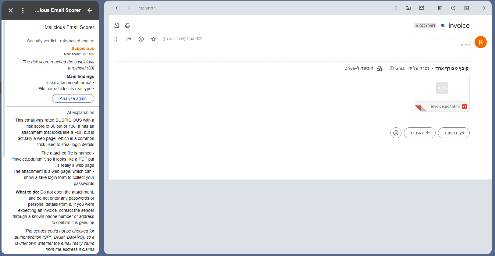
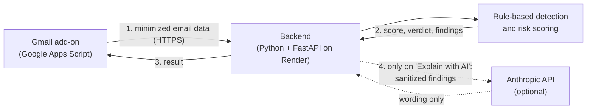

# Malicious Email Scorer - a Gmail Add-on

When a user opens an email in Gmail, this add-on shows a **risk score from 0 to 100**, a **verdict**
(Low risk, Suspicious, or Likely malicious) and **the evidence behind every point**. It is aimed at
phishing that reaches the inbox: look-alike sender domains, spoofed senders, deceptive links, risky
attachments, and requests for passwords or money.

The decision is made by a **rule-based engine** in a small Python backend. The same email always gets
the same score, and every point can be traced to a named rule and a piece of evidence. An optional
**"Explain with AI"** button asks a language model to describe the finished result in plain words. The
model never sees the email text and cannot change the score or the verdict.



_The add-on on a synthetic test email with an attachment named `invoice.pdf.html`: Suspicious, 30/100,
with the AI explanation requested._

**Try it in two minutes** - no Gmail account or API key needed:

```bash
cd backend
python -m venv .venv
source .venv/bin/activate          # Windows: .venv\Scripts\activate
pip install -r requirements-dev.txt
pytest -q                          # run the automated tests (offline)
python -m demo.run_demo full       # score a synthetic phishing email
```

## Contents

[Features and scope](#features-and-scope) · [Architecture](#system-architecture) ·
[Repository structure](#repository-structure) · [Detection and scoring](#detection-and-scoring) ·
[Design decisions](#design-decisions-and-trade-offs) · [Security and privacy](#security-and-privacy) ·
[Setup](#installation-and-setup) · [Testing](#testing-and-validation) ·
[Limitations](#known-limitations-and-future-improvements) · [Live demo](#live-demo)

## Features and scope

| Capability | What it looks for |
|---|---|
| **Sender authentication** | Whether the sender's domain passed SPF, DKIM and DMARC - the checks that show an email really comes from the domain it claims. |
| **Sender impersonation** | Domains that imitate known brands (`paypa1-secure.com`), brand names or hidden addresses in the sender's name, and replies redirected to a different domain. |
| **Suspicious links** | Links whose visible text shows one website but lead to another, links to look-alike or raw IP addresses, and other tricks that disguise the destination. |
| **Attachment metadata** | Programs and scripts, macro-enabled Office files, web-page attachments, and names like `invoice.pdf.exe` that hide the real file type. |
| **Suspicious content** | Requests for passwords or money (including changed bank details), with urgency or account threats as supporting signs. English and Hebrew. |
| **Explain with AI** (optional) | A short, plain-language explanation of the result, on request. |

**What it focuses on.** The project aims for **explainable, rule-based phishing detection** that a
security reviewer can check line by line: email authentication, sender identity, suspicious links,
attachment metadata, and basic suspicious content patterns. It does **not** open or run attachments,
visit the websites in an email, or query external malware or reputation services. These limits are
deliberate - they keep the system predictable, private and easy to reason about - and they are
discussed under [Limitations](#known-limitations-and-future-improvements).

## System architecture



1. When an email is opened, the **Gmail add-on** reads that one message, keeps only the parts the
   checks need, and sends them to the backend over HTTPS.
2. The **backend** validates the request and runs the **detection engine**, which calculates the
   score and verdict.
3. The add-on displays the result. Opening an email never involves an AI service.
4. Only if the user clicks **"Explain with AI"**, the backend recalculates the same result and sends a
   sanitized summary of the findings to **Anthropic**. The reply is used only as explanatory text; the
   score and verdict come from the engine and cannot be changed by it.

## Repository structure

| Path | Responsibility |
|---|---|
| `addon/` | The Gmail add-on: reads the opened email, calls the backend, draws the card (Google Apps Script) |
| `backend/app/main.py`, `security.py`, `schemas.py` | The API: endpoints, API key check, request validation |
| `backend/app/engine/` | Detection and scoring: one file per check in `checks/`, all weights in `signals.py`, scoring rules in `scoring.py` |
| `backend/app/explain/` | Plain-language explanations: a fixed template, the optional AI explanation, and its system prompt |
| `backend/demo/` | Offline examples on synthetic emails |
| `backend/tests/` | Automated tests |
| `docs/` | Detailed signal reference and the screenshot |

## Detection and scoring

### What the checks do

- **Sender authentication** (`checks/authentication.py`). Gmail records whether an email passed SPF,
  DKIM and DMARC. Because anyone can add a fake version of that record to an email, only results
  written by Gmail itself are trusted. Forwarded mail that fails SPF but passes DMARC is not penalized.
- **Sender impersonation** (`checks/lookalike.py`, `display_name.py`, `reply_to.py`). Look-alike
  domains are found through swapped characters (`paypa1`), realistic typos, other domain endings, the
  brand combined with words like "secure" or "login", and the brand used as a subdomain. To avoid false
  alarms, domains really owned by a brand (`google-analytics.com`) and unrelated companies with similar
  names (`paypay.ne.jp`) are excluded, and only whole words are compared (`applebees.com` is not Apple).
- **Links** (`checks/links.py`). Links are read as text and never opened. Click-tracking services used
  by newsletters are not counted as deceptive.
- **Attachments** (`checks/attachments.py`). Only the file name, declared type and size are used. The
  real extension is read the way Windows reads it, so hidden characters cannot disguise `.exe` as `.pdf`.
- **Content** (`content.py`). A finding needs a combination within one sentence - for example a word
  like "password" together with an action like "verify". Single words never count.

The complete list of signals and rules is in [docs/detection-design.md](docs/detection-design.md).

### How the score is calculated

All weights are defined in one place, `backend/app/engine/signals.py`; the rules that combine them are in
`backend/app/engine/scoring.py`. The goal of the rules is that **the same evidence is never counted twice**,
so overlapping findings cannot inflate the score.

1. **Deduplication** - if the same suspicious signal appears several times (for example in ten links), it counts once.
2. **Correlation** - if two findings describe the same behaviour, only the stronger one counts. Example: a
   DMARC failure already includes the SPF failure that caused it.
3. **Reinforcement** - a weaker finding that supports a stronger finding about the *same brand or file*
   adds only 5 points instead of its full weight.
4. **Category caps** - each kind of evidence has a maximum, so no single category can dominate.
5. **Final score** - the category totals are added and capped at 100. Positive findings, such as a
   passed DMARC check, are shown but do not subtract points, because attackers can also authenticate
   their own look-alike domains.

| Category (maximum) | Signals and points |
|---|---|
| Sender authentication (30) | DMARC fail 25 · SPF fail 10 · SPF softfail 5 · DKIM fail 8 · no DKIM signature 3 |
| Sender identity (45) | Look-alike sender domain 35 · look-alike Reply-To 20 · free mailbox presenting itself as an organization 12 · brand in sender name 10 · different address in sender name 10 · replies go to another domain 6 |
| Links (35) | Text shows one site, link opens another 25 · look-alike destination 15 · raw IP address 15 · `@` trick 15 · deceptive structure 8 · frequently abused domain ending 5 · URL shortener 5 · unencrypted http 3 |
| Attachments (35) | Program or script 30 · macro document 20 · web page or disk image 15 · double extension 15 · name and type disagree 5 |
| Content (15) | Password or login request 10 · payment or bank-details request 10 · urgency or threat 5 |

**Verdict.** 0-29 is **Low risk** (worded "no strong warning signs", never "safe"), 30-69 is
**Suspicious**, and 70-100 is **Likely malicious**. One strong finding - such as a look-alike domain -
is always at least Suspicious, but never Likely malicious on its own: no category can exceed 45 points,
so reaching 70 requires evidence of more than one kind. If no check could run, the verdict is
**Inconclusive**. Missing information never adds points, and the card lists any check that could not run.

**Example** (checked by `test_independent_evidence_across_categories_reaches_malicious` in
`backend/tests/test_check_links.py`). A synthetic email from `"PayPal Service" <service@paypa1-secure.com>`
that passes DMARC and contains a link showing `https://www.paypal.com` but opening `https://paypal-verify-login.com`:

| Finding | Points | Reason |
|---|---|---|
| Sender domain imitates PayPal | 35 | `paypa1` looks like `paypal`, combined with `secure` |
| "PayPal" in the sender's name | 5 (of 10) | Supports the finding above about the same brand |
| Link text shows a different site | 25 | Shows paypal.com, opens another domain |
| Link destination imitates PayPal | 5 (of 15) | Supports the finding above about the same brand |
| DMARC pass | 0 | Shown as a reassuring sign, not subtracted |
| **Total** | **70** | Sender identity 40 + links 30 -> **Likely malicious** |

Without reinforcement, the same evidence would add up to 85 by counting the PayPal impersonation twice.

**What the score means.** The weights are **engineering judgments**, based on how strong each signal is,
how often it appears in legitimate email, and whether it overlaps with other signals. They have **not
been statistically calibrated** on labelled real-world email. A score of 85/100 is a level of concern,
**not an 85% probability** that the email is malicious.

## Design decisions and trade-offs

| Decision | Rationale | Trade-off |
|---|---|---|
| Google Apps Script add-on | The supported way to extend Gmail; Google handles sign-in and grants access to the opened email only | Limited UI, 30-second limit per action, no automated tests for the add-on code in this repository |
| Separate Python backend | Detection logic is easy to test in Python and lives in one place | Limited email data leaves Google; one more service to run and secure |
| FastAPI | Request validation and a typed API with little code | Needs Python hosting; the free hosting plan sleeps when idle |
| Rule-based scoring instead of a model-based classifier | Reproducible, explainable, testable, and the email's own text cannot talk the engine into a different score | Fixed rules miss new attack patterns; weights are not learned from data |
| Correlation, reinforcement and caps | Overlapping evidence is not counted twice | More rules to explain; a single strong signal stays at Suspicious |
| Attachment metadata only | No need to download or run untrusted files | A malicious file with an ordinary name is not detected |
| Simple content rules (English and Hebrew) | Transparent and testable | Rephrasing avoids them; genuine security notices produce small findings |
| Links reduced to their domain | Password-reset tokens and tracking IDs in links are not sent | Paths and redirect parameters are not inspected |
| AI explanation only on request | No cost and no data sent to Anthropic when an email is opened | One extra click; the first click after a restart can be slow |
| Fixed-template fallback | A complete result is always shown, even without the AI service | Less natural wording |

## Security and privacy

- **Minimal Gmail access.** The add-on can read only the email the user has open, through a short-lived
  token from Gmail, and can contact only the configured backend. It cannot read the rest of the mailbox.
- **Data minimization.** The add-on sends the backend only what the checks need: selected headers, the
  domain of each link (not its path or parameters), attachment names and types (never the files), and
  up to 8,000 characters of text with web addresses removed. This is still email-derived data leaving
  Gmail, so it is kept as small as possible.
- **Backend authentication and validation.** Every request must carry a shared API key, and requests
  with unexpected fields or oversized values are rejected. The key authenticates the add-on, **not each
  Gmail user**: anyone who obtained the key could call the API.
- **Secrets.** API keys are stored in the hosting provider's environment settings and in Apps Script's
  private project settings - never in the code or the repository.
- **AI privacy.** The optional AI call receives a separate, sanitized summary of the findings - no email
  text, headers, attachments, sender names, mailbox names or full links (domains and file names remain). Email-derived evidence is marked as
  untrusted data, so instructions hidden in an email are not followed as commands. Replies that change
  the score, claim certainty or are incomplete are discarded.
- **Safe failures.** If a check, the backend or the AI service fails, the user still sees a result or a
  clear message, and nothing is ever marked safe because it could not be checked. Logs contain scores,
  rule names, timings and AI token counts - no email content, addresses or keys.

This is a working prototype, **not a production-ready service**. Known gaps: one shared key with no
rotation or rate limiting, free hosting that sleeps when idle, and a test installation of the add-on
that has not gone through Google's verification.

## Installation and setup

**Prerequisites:** Python 3.14 (the version used for development and testing, see `backend/.python-version`),
Node.js (to install Google's `clasp` tool), and a Google account.

### Run the backend locally

```bash
cd backend
python -m venv .venv
source .venv/bin/activate                # Windows: .venv\Scripts\activate
pip install -r requirements-dev.txt      # application + test dependencies
export API_KEY="<long-random-value>"     # Windows PowerShell: $env:API_KEY = "<long-random-value>"
uvicorn app.main:app --port 8000
```

Check that it runs: open `http://localhost:8000/health`, which returns `{"status": "ok", ...}`.

### Deploy the backend to Render

Create a **Web Service** from this repository with these settings:

| Setting | Value |
|---|---|
| Root directory | `backend` |
| Build command | `pip install -r requirements.txt` |
| Start command | `uvicorn app.main:app --host 0.0.0.0 --port $PORT` |
| Health check path | `/health` |

| Environment variable | Required? | Purpose |
|---|---|---|
| `API_KEY` | **Required** | Shared secret the add-on sends with every request |
| `ANTHROPIC_API_KEY` | Optional | Enables the "Explain with AI" button |
| `LLM_MODEL` | Optional | AI model (default `claude-haiku-5-5`) |
| `LLM_MAX_TOKENS` | Optional | Maximum length of the AI reply in tokens (default 400) |
| `LLM_TIMEOUT_SECONDS` | Optional | AI request timeout (default 12) |

### Install the Gmail add-on

First enable the Apps Script API at https://script.google.com/home/usersettings, then:

```bash
npm install -g @google/clasp
clasp login
cd addon
clasp create --type standalone --title "Malicious Email Scorer" --rootDir .
git checkout appsscript.json             # "clasp create" overwrites the manifest; restore ours
clasp push --force
```

1. In `addon/appsscript.json`, set `urlFetchWhitelist` to your backend address
   (`https://<your-backend-host>/`) and run `clasp push --force` again.
2. In the Apps Script editor, open **Project Settings -> Script properties** and add `BACKEND_URL`
   (`https://<your-backend-host>`) and `API_KEY` (the same value as on the backend).
3. Choose **Deploy -> Test deployments -> Install**.
4. Open Gmail, open an email, and click the add-on icon in the side panel (it appears on the left when
   Gmail is set to a right-to-left language). Approve the requested permissions - Google shows an
   "unverified app" warning for test installations.

**Check that it works:** the card shows a verdict and a "What was checked" section. If it shows
"Analysis unavailable", the backend address or key is wrong, or the free backend is still waking up -
click "Analyze again".

When updating both parts, **deploy the backend first** - it rejects fields it does not know, so a newer
add-on needs the matching backend.

## Testing and validation

```bash
cd backend
pytest -q                 # 344 tests, all passing at the time of writing; no network access
```

- **Automated tests** cover each check (legitimate and malicious examples, malformed and missing data,
  Hebrew and international domains), the scoring rules (deduplication, correlation, reinforcement, caps,
  exact verdict thresholds), the API (authentication, size limits, unexpected fields) and end-to-end
  scenarios.
- **AI explanation tests use a simulated Anthropic service.** They check that opening an email never
  calls the AI, that the button calls it once even when clicked repeatedly, that the AI cannot change the
  score, verdict or findings, and that timeouts, refusals, cut-off or malformed replies fall back to the
  fixed template.
- **Manual tests in Gmail:** the add-on was tested in a real Gmail account against the deployed backend,
  including "Explain with AI" on synthetic emails (see the screenshot), and one live call to Anthropic
  with a synthetic email.
- **Not covered by automated tests:** the add-on's Apps Script code (reading the email, removing link
  details, drawing the card), which was checked manually and with a local test harness that is not part
  of this repository.

**What the tests do and do not show.** Passing tests show that the software behaves as designed. They do
**not** measure how many real phishing emails it would catch or how many legitimate emails it would flag
- that would require evaluation on real, labelled email.

## Known limitations and future improvements

**Limitations**

- **Missed attacks (false negatives).** A payment-fraud email with no link or attachment scores about 21
  (Low risk), because each of its signs is also common in legitimate mail. Brands outside the built-in
  list are not protected against look-alikes. A malicious website on an ordinary-looking domain is not
  recognized.
- **False alarms (false positives).** Brands that send through third-party mailing services get a small
  sender-name finding, and genuine "reset your password" emails get small content findings. Both stay
  Low risk by design.
- **Limits of the evidence.** Authentication shows which domain sent an email, not whether it is honest.
  File names say nothing about file contents. Content rules can be avoided by rephrasing.
- **Platform.** The free backend sleeps after inactivity, and an add-on action must finish within 30 seconds.

**What I would improve next, in order**

1. **Calibrate the weights with labelled data.**
   *Why:* today's weights are reasoned engineering choices, not measured ones. Measuring **precision**
   (how many flagged emails are really malicious) and **recall** (how many malicious emails get flagged)
   per signal would show which weights to change.
   *Example:* if many legitimate emails were flagged because of a different Reply-To address, the data
   would justify lowering that signal's weight.
2. **Detect business email compromise (BEC) better.**
   *Why:* payment-fraud emails often contain no link or attachment, so today they score low.
   *Example:* an email that claims to come from a finance manager and asks for a bank transfer to a new
   account, with replies going to a personal mailbox.
3. **Check links against a reputation service.**
   *Why:* a link can look completely normal and still lead to a known phishing site.
   *Example:* a phishing page hosted on an ordinary-looking domain could be recognized through an external
   threat database. The privacy impact of sending link information to that service would need to be
   designed carefully.
4. **Make it production-ready.**
   *Why:* a real deployment needs stronger reliability and access control.
   *Example:* rate limiting would stop excessive requests, per-user authentication would replace the
   shared key, and an always-on backend would avoid the delay after inactivity.

## Live demo

Use your own Gmail account and synthetic emails sent to yourself. Do not click the links.

1. **Low-risk email.** Open an ordinary notification already in your inbox. *Expected:* Low risk, with
   "Sender domain verified (DMARC pass)" under reassuring signs.
2. **Suspicious email.** Send yourself an email containing three lines: `https://www.paypal.com`
   (select it, press Ctrl+K, and link it to `https://example.com`), `http://192.0.2.1`, and
   "Your account will be suspended within 24 hours. Please verify your password." Open it from your Sent folder.
3. **Score and findings.** *Expected:* Suspicious, 50/100 - deceptive link 25, raw IP address 10 (the
   links category is capped at 35), password request 10, urgency 5. The technical findings show the evidence.
4. **Explain with AI.** Click the button. *Expected:* an "AI explanation" section appears below the result.
5. **The decision does not change.** The score and verdict above the explanation stay exactly the same.
